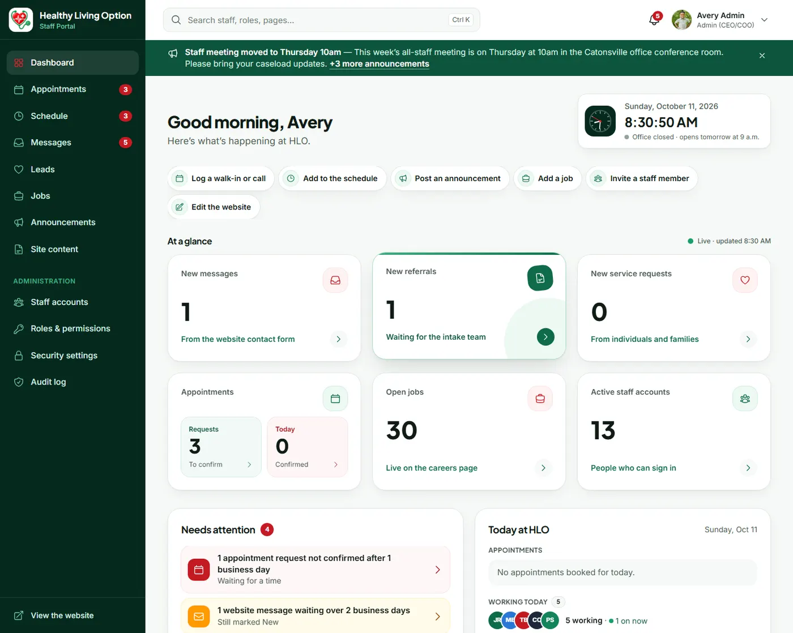
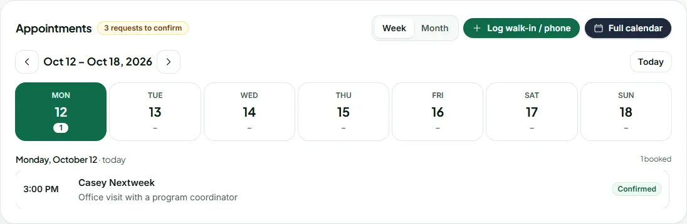
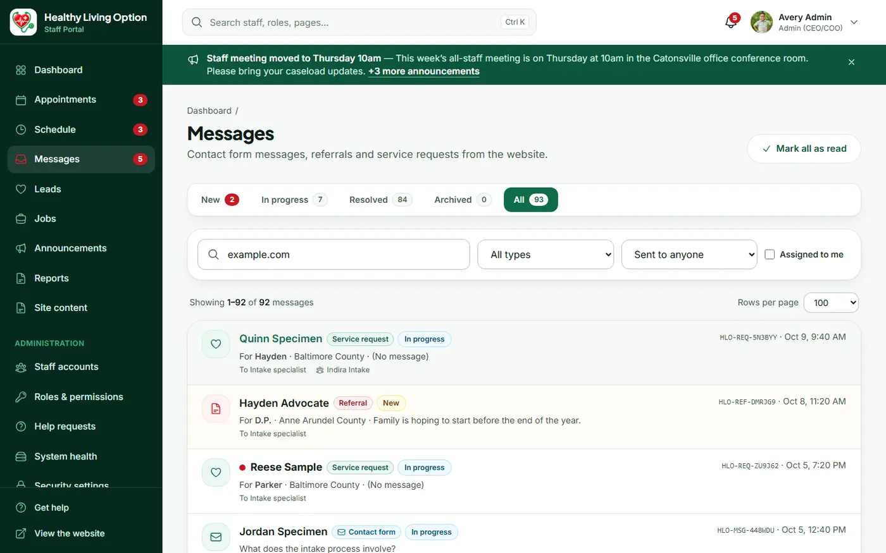
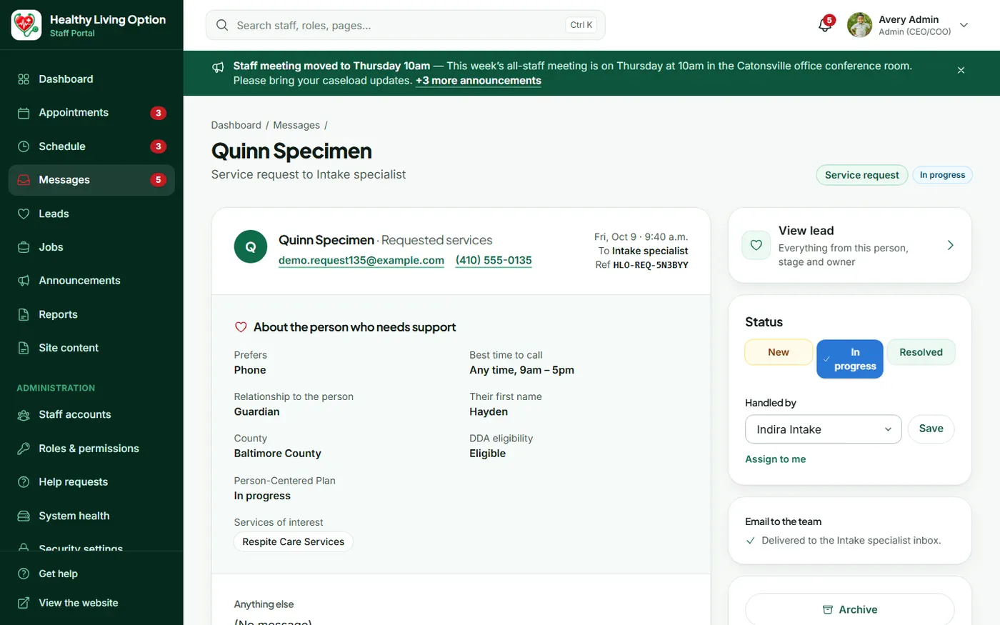
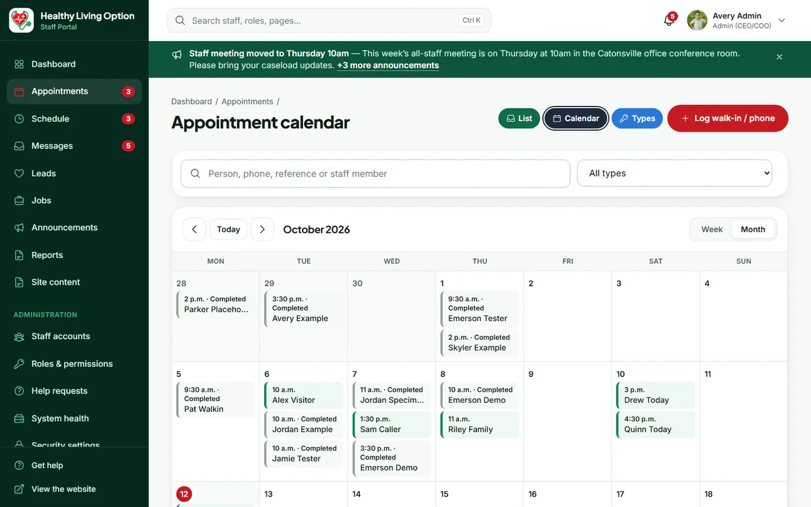
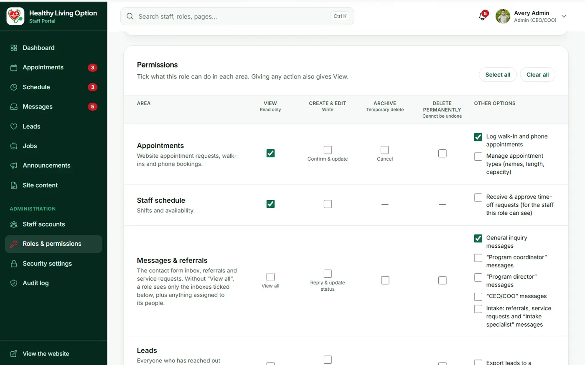
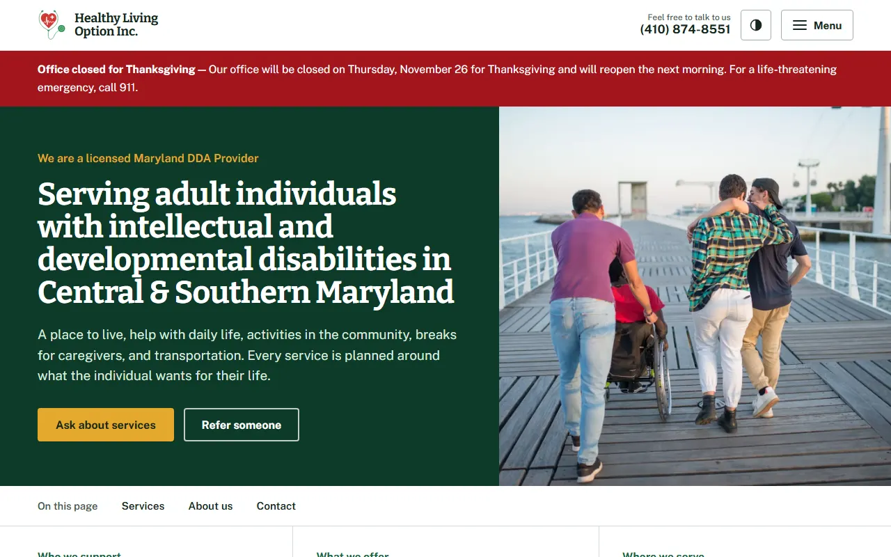
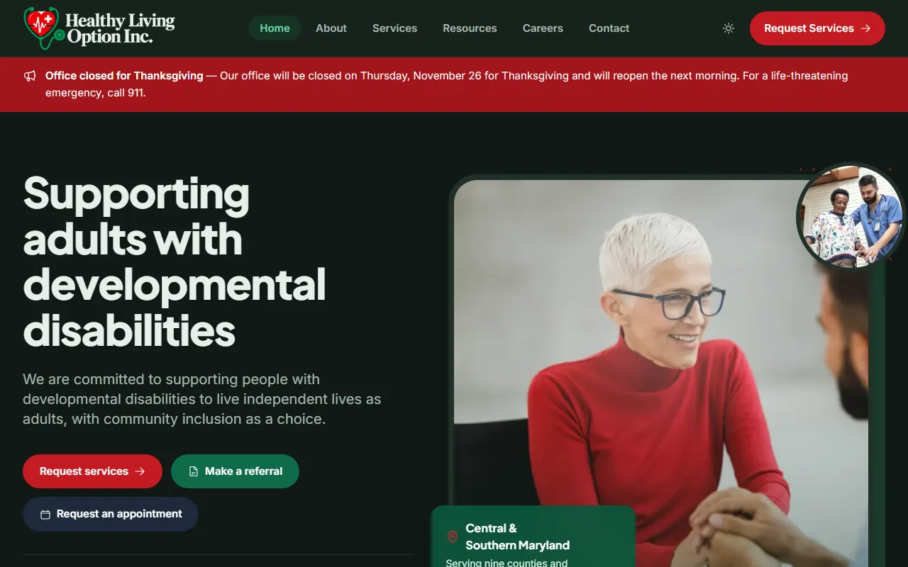
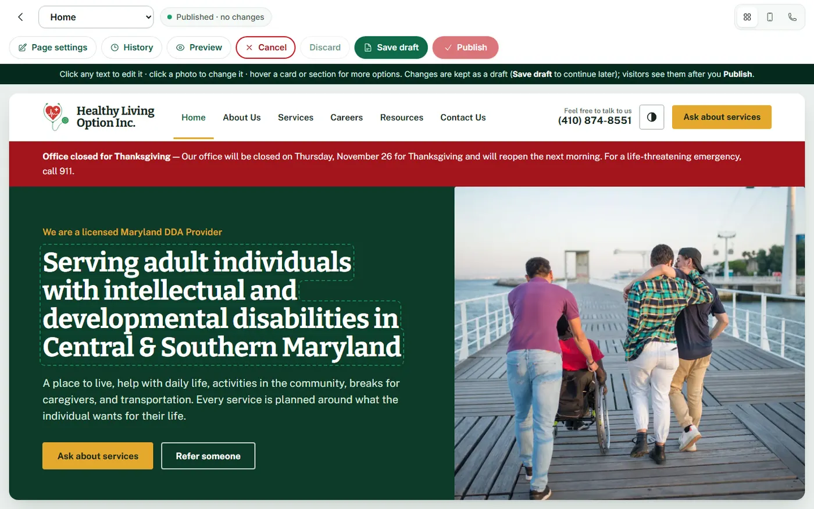
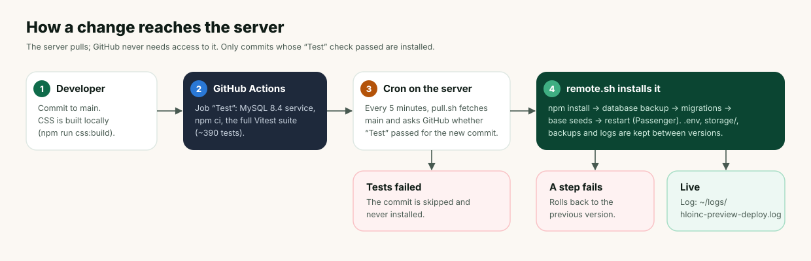

# HLO Inc. — Website & Staff Portal

The public website and the role-based staff portal for **Healthy Living Option Inc.**, a Maryland DDA provider supporting adults with developmental disabilities. One Node.js (Express) app, server-rendered, built for shared cPanel hosting.

- **Public website**: services, careers (apply online with a resume), contact, request services, referrals, appointment requests, announcements, light and dark theme.
- **Staff portal** (`/portal`): live dashboard, messages, leads, appointments, schedule and time off, jobs and applications, announcements, site content editor, staff accounts, roles and permissions, audit log.

Scope and phases: [ROADMAP.md](ROADMAP.md) · Hosting and deployment: [DEPLOY.md](DEPLOY.md) · Photo credits: [docs/photo-sources.md](docs/photo-sources.md)

## Architecture


**How a request is handled**

1. **Security layer** (every request): Helmet sets a strict Content Security Policy (no inline scripts or styles). Sessions are stored in MySQL. Every form post needs a CSRF token, rate limits apply, and public forms run bot checks (honeypot, minimum fill time, optional Cloudflare Turnstile).
2. **Routes**: `src/routes/public.js` serves the website. `src/routes/portal/*` serves the staff portal, behind sign-in and optional two-step sign-in (TOTP). Each portal area checks the role's permissions.
3. **Services** (`src/services/*`) hold the business rules. Routes stay thin.
4. **Views**: Nunjucks templates styled with Tailwind CSS v4. The CSS is compiled locally and committed, so the server never builds anything. JavaScript is small and progressive: pages work without it.
5. **Data**: MySQL through Knex (migrations in `src/db/migrations`). Private files live in `storage/` and are never served directly.

**Design decisions worth knowing**

| Decision | Why |
|---|---|
| Server-rendered, no SPA, no build on the server | Shared hosting, fast pages, fewer moving parts |
| Permissions per role, edited in the portal (`src/auth/permissions.js`) | HLO can create roles and adjust access without code changes; Admin always has everything |
| Message inboxes per contact-form choice, plus "assigned to me" | Staff see only what was sent to their role, while Admin sees all |
| Error pages show a reference (`ERR-…`) that is also in the server log, and offer "Report this problem" | Staff can quote it, and it is attached to their help request |
| Alerts chosen per role (Roles & permissions → Alerts) | Who is *told* about new items is separate from who can *see* them |
| Live dashboard by polling (10 s) a fingerprint, then fetching changed HTML | Real-time feel without websockets on shared hosting |
| Formatted text (replies, job descriptions) cleaned with `sanitize-html` (`src/lib/richText.js`) | Staff get a proper editor; only safe tags, links and four text sizes are ever stored or sent |
| Resumes: real-type checks, virus scan, AES-256-GCM encryption, never emailed | Applicants' documents are personal data |
| The server pulls deployments (cron), only for commits whose tests passed | No inbound access or secrets needed on GitHub |

### Main features

**Public website** (HLO's design, version 20, October 2026; Home, About, Services, Resources, Contact, Careers, header, footer and legal pages from version 41, October 14)
- Pages: Home, About, Services, Resources, Careers, Contact, Ask about services, Send a referral, Privacy policy, Accessibility, Nondiscrimination and language help.
  - Home: who we are and our values, the six services in three groups, how getting started works, common questions, and contact details with the map.
  - Terms, Data Protection and Cookie Policy are hidden from the footer and sitemap but still open by address (`LISTED` in `src/content/legal.js`). The cookie list is in the Privacy policy.
  - Built from HLO's design file: deep-green headings, gold buttons, Bitter and Public Sans fonts, a sticky "On this page" bar, a Services dropdown, Previous/Next page links, and a county checker on the home page. Styles are in `public/css/site.css` (classes prefixed `d-`), behaviour in `public/js/ds.js`, shared pieces in `src/views/partials/ds*.njk`, starting text in `src/content/design.js`.
  - Ask about services and Referral are three-step forms (about you, about them, review); they still work without JavaScript.
  - Getting started, Service areas, the single service pages and Request an appointment are hidden, not deleted: old links go to the matching section (see `HIDDEN` in `src/routes/public.js` and `HIDDEN_PAGES` in `src/services/cms.js`).
  - Careers (version 41 layout): open positions first (from Jobs; each has an Apply button and "Role details" with pay), then benefits, then one **Apply online** form (resume upload, cell number, optional message) that sends to Applications. It also takes a **general application** (no specific role), which shows on an empty jobs list too. Old job links open that job on the page. The previous Careers design is kept: `careers-old.njk`, switched on with `OLD_CAREERS` in `src/routes/public.js`.
- **Forms**:
  - Contact (to the General inquiry inbox), Ask about services, Send a referral, Job application with resume upload.
  - Each form gives a reference number (e.g. `HLO-REQ-7K3M9P`) and sends a branded confirmation email.
- **Careers**: open jobs from the portal with their details and pay, one apply form with resume upload, and a clear "no openings" message when nothing is posted.
- **Announcements**: banners for the public site, staff or both, with start and end dates and pause/resume.
- **Light and dark theme**: follows the visitor's device, with a sun/moon switch in the header. The staff portal always stays light.
- **Visual page editor** for site text and photos: drafts, preview, publish and version history.

**Staff portal**
- **Menu** grouped by job: Inbox, Scheduling, Hiring, Website, Administration.
- **Dashboard** (live):
  - Cards and charts, plus "Needs attention" and "Today at HLO".
  - **Appointments** widget (roles that see appointments): Week or Month view with the number booked per day; pick a day to list its appointments, hover for details.
  - The staff announcement board and recent leads.
  - Recent activity (audit-log roles) or **My work** (everyone else), and My shifts.
- **Messages**:
  - Quick views: All, Contact messages, Intake (referrals and service requests), Assigned to me.
  - Inboxes per role and "Contact form" badges.
  - **Send to…**: Reception passes a contact page message to the team who should handle it; that team gets a bell alert and an email (permission "Send messages on to another team").
  - **Book a meeting** from a message: the appointment starts from the message's details, joins the same lead and shows in the message's history.
  - Coloured statuses, searchable "Handled by" and internal notes.
  - Formatted email replies.
  - Overdue alerts, and email to the person a message is assigned to.
- **Leads**: everyone who reached out, with stage, owner, timeline and CSV export.
- **Appointments** (booked by staff): list, calendar, appointment types, walk-in/phone logging, confirmation emails, and a **reminder email the day before** (from 10 a.m., with Add to Google Calendar and directions). Website appointment requests are switched off in `src/lib/features.js` (`appointmentRequests`); switching them on brings back the Requests tab, counter, alerts and reports.
- **Schedule**: team and personal views, shifts, and time-off requests with approval (in-app and email).
- **Jobs & applications**:
  - Posting with a formatted editor and Maryland pay-transparency checks.
  - Applications with status tracking, a **resume preview** in a pop-up (PDF in the browser's viewer; Word shown as text) and logged previews and downloads. Resumes are **deleted automatically after 3 months** (the application is kept).
- **Announcements**: a banner across the portal. **Important** (red, stays, bell alert to all staff) or **Normal** (green, can be closed).
- **Accounts**:
  - Invites, password and two-step resets, sign out everywhere.
  - **Suspend** or deactivate.
  - Profile photos (initials when there is no photo).
- **Roles & permissions**: per-area permissions, which inboxes each role sees, and the alerts grid.
- **Monthly report** (Reports): referrals, service requests, appointments, leads, contact messages, applications and hires for any month against the month before, on screen or as a branded **PDF** (drawn with `pdfkit`, no browser needed on the server) and **CSV**. Counts only, no names, so it can go to the board.
- **Get help** (every page): staff report a problem or ask a question, with an optional screenshot. The page, browser and any error reference are sent along. IT and Admin are told by bell and email; "Something isn't working" reports can also be emailed to a developer/support address. Replies, and Open → In progress → Fixed, in **Help requests**.
- **System health** (IT and Admin): email delivery and recent failures, the virus scanner and Cloudmersive scans used this month, database backups (daily, plus **Back up now**), the installed version, storage and database size. Checked every 15 minutes; IT and Admin are alerted by bell and email when something breaks.
- **Security settings** (two-step sign-in on or off for everyone), **Audit log**, global search, notifications (bell) and menu counters.

## Screenshots

Taken from a local copy with demo data (`npm run screens:readme`).

| | |
|---|---|
|  **Admin dashboard**: live cards, quick actions, staff banner |  **Reception**: appointments widget, Week or Month |
|  **Messages**: inboxes, badges, filters |  **Message page**: status, handled by, history |
|  **Appointments**: calendar, week and month |  **Roles & permissions**: set per area by Admin |
|  **Website**: light theme |  **Website**: dark theme |
|  **Site content**: edit the website in place | |

## Local setup

Requires **Node 20+** (production runs Node 24) and **MySQL 8** or MariaDB.

```bash
npm install
cp .env.example .env          # set DB_*, SESSION_SECRET and APP_KEY (32+ characters each)
# create the database: CREATE DATABASE hloinc CHARACTER SET utf8mb4 COLLATE utf8mb4_unicode_ci;
npm run migrate
npm run seed                  # site settings, appointment types, and demo data in development
npm run create-admin -- --name "Your Name" --email you@example.com
npm run css:watch             # terminal 1
npm run dev                   # terminal 2
```

> On this dev machine WAMP runs MySQL 8.4 on port **3308** (MariaDB is on 3306), and the app runs on
> port **4310** because 3000/3100 are used by other projects.

Without SMTP settings, emails are printed to the server console. Without a virus scanner, development uses a basic built-in check (refused in production).

### Demo data

Development seeds demo staff (one per role), jobs, appointments, shifts, messages, leads, announcements and time off, so every screen has something to show. Demo staff sign in with password `Portal-Demo-2026!`:
`admin@hloinc.test`, `it@hloinc.test`, `director@hloinc.test`, `coordinator@hloinc.test`, `intake@hloinc.test`, `reception@hloinc.test`.

- **In production**, demo data loads only when the server's `.env` has `DEMO_DATA=true`. It then uses `DEMO_PASSWORD` from the server (12+ characters), never the password above, since this repository is public.
- **Remove it** with `npm run demo:remove` (add `-- --keep-staff` to keep the demo accounts).

## Configuration

All settings come from `.env` (see [.env.example](.env.example)); they're checked at start-up (`src/config/index.js`).

| Setting | Purpose |
|---|---|
| `NODE_ENV`, `APP_URL`, `PORT` | Environment, public address (used in emails), port (not set on cPanel) |
| `SESSION_SECRET`, `APP_KEY` | Session signing; encryption key for two-step secrets **and resumes** (keep it safe and unchanged) |
| `SESSION_IDLE_MINUTES`, `SESSION_MAX_HOURS` | Staff sign-out after inactivity / after this many hours |
| `DB_HOST`, `DB_PORT`, `DB_NAME`, `DB_USER`, `DB_PASSWORD` | MySQL connection (tests use `<DB_NAME>_test`) |
| `MAIL_TRANSPORT` (`smtp` or `sendmail`), `SENDMAIL_PATH`, `SMTP_*`, `MAIL_FROM` | Outgoing email |
| `TURNSTILE_SITE_KEY`, `TURNSTILE_SECRET_KEY` | Optional Cloudflare Turnstile on public forms |
| `FORMS_MAX_PER_EMAIL_PER_DAY` | Submissions allowed per email address per day |
| `RESUME_KEEP_DAYS` | Days to keep resumes before they're deleted automatically (default 90) |
| `APPOINTMENT_REMINDERS` | `false` to stop the day-before reminder emails (default `true`) |
| `CLOUDMERSIVE_MONTHLY_LIMIT` | Scans a month on your Cloudmersive plan (default 800, the free plan); System health warns at 80% |
| `VIRUS_SCAN`, `CLOUDMERSIVE_API_KEY`, `RESUME_MAX_MB` | Resume scanning (`auto` uses Cloudmersive when a key is set) and the size limit (2.5 on Cloudmersive's free plan) |
| `CLAMD_SOCKET`, `CLAMD_HOST`, `CLAMD_PORT`, `CLAMSCAN_PATH`, `CLAMAV_DATABASE`, `CLAMAV_CERTS_DIR` | ClamAV, where the server can run it |
| `DEVELOPER_EMAIL` | Optional: where "Get help" problem reports are forwarded (Admin can switch forwarding off under Help requests) |
| `NOINDEX` | `true` on preview copies: keeps search engines out |
| `DEMO_DATA`, `DEMO_PASSWORD` | Demo data on a production preview (see above) |

Team mailboxes (where each form is emailed) are set in the portal under **Site content → Team email addresses**, not in `.env`.

## Scripts

| Script | What it does |
|---|---|
| `npm run dev` / `npm start` | Start with auto-restart / start (production) |
| `npm run css:build` / `css:watch` | Compile Tailwind to `public/css/app.css` (commit the output) |
| `npm run migrate` / `migrate:rollback` | Database migrations |
| `npm run seed` | Site settings and appointment types (safe to re-run); demo data where allowed |
| `npm run create-admin` | Create an Admin account from the terminal |
| `npm run demo:remove` | Remove demo data (`-- --keep-staff` keeps demo accounts) |
| `npm run alerts:overdue` | Run the "waiting too long" check once (the app also runs it every 15 minutes) |
| `npm test` / `test:watch` | Vitest + Supertest (~390 tests; needs local MySQL, uses `<DB_NAME>_test`) |
| `npm run test:a11y` | WCAG 2.1 AA scan with axe (app must be running) |
| `npm run screens -- <outDir> <paths…>` | Desktop and mobile screenshots (app must be running) |
| `npm run screens:readme` | Retake the README screenshots in `docs/screens/` (local app with demo data only) |

## Testing and deployment



- Every push runs the **Test** job on GitHub Actions (MySQL 8.4, `npm ci`, `npm test`).
- The server does not receive pushes. Every 5 minutes a cron job (`scripts/deploy/pull.sh`) installs the newest commit on `main` whose Test job passed. It runs `scripts/deploy/remote.sh`: install, database backup, migrations, base seeds, restart. If any step fails, it rolls back.
- Setup and server details: [DEPLOY.md](DEPLOY.md).

## Project layout

```
app.js                  entry point (Passenger / cPanel); starts background checks
knexfile.js             database config
config/clamav-certs/    ClamAV's public signing certificate (for clamscan)
src/
  config/               environment loading and validation
  server.js             Express app: security, sessions, views, routes
  auth/permissions.js   permission catalog, built-in roles, inbox permissions
  middleware/           security (CSP, CSRF, rate limits), auth, session, errors
  routes/               public.js (website), portal/* (staff portal), upload handlers
  services/             business rules (messages, alerts, leads, jobs, applications,
                        appointments, schedule, time off, announcements, CMS, users, …)
  lib/                  helpers: site defaults, icons, email layout, rich text,
                        references, phone formats, spam checks, crypto, avatars
  content/              default page text, services, areas, legal pages
  validation/           zod schemas for forms
  db/migrations, seeds  schema history; base and demo seeds
  views/                Nunjucks layouts, partials and pages
  assets/css/app.css    Tailwind source, design tokens, dark theme
public/                 static files (built CSS, JS, images, fonts)
storage/                private files: uploads, encrypted resumes, avatars (not in git)
scripts/                CLI tools and deploy scripts
docs/                   diagrams, README screenshots and photo sources
tests/                  Vitest + Supertest; e2e/ for accessibility and screenshots
```

## Security and privacy at a glance

- **Staff sign-in**: bcrypt passwords, lockout after repeated failures, optional or per-role two-step sign-in, sessions that expire and can be revoked, and "sign out everywhere".
- **Access**: every portal route checks permissions. Staff can only manage accounts with no more access than their own, and the last Admin can't be removed or suspended.
- **Privacy in email**:
  - Referral and service-request emails to the team contain no personal details. Staff read them behind the portal sign-in.
  - Resumes are never emailed.
- **Audit log**: sign-ins, changes, downloads and deletions are recorded.
- **Kept out of git**: `.env`, `storage/` and client documents. The repository is public.
